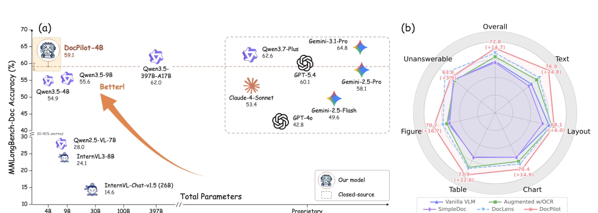
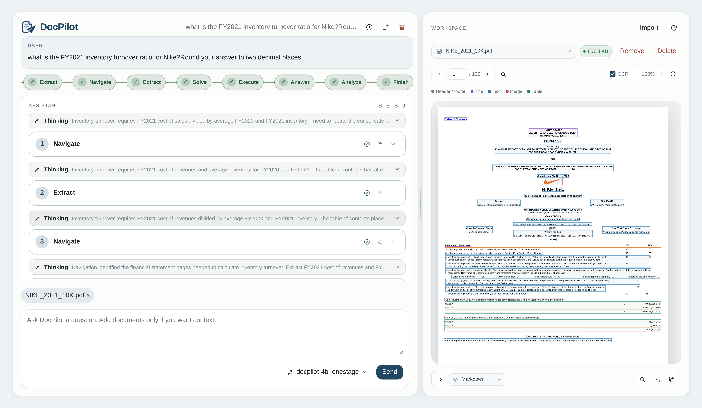
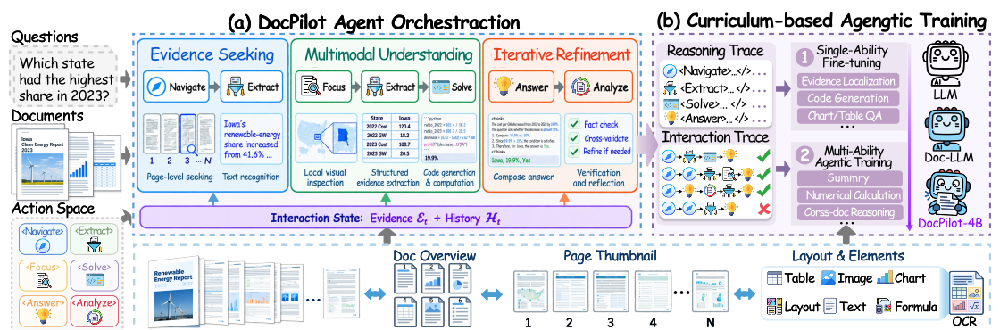
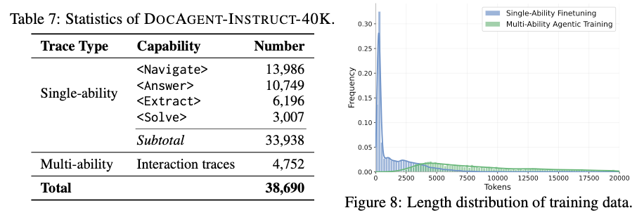

<div align="center">

<h1>
  
  DocPilot: Interactive Agent Orchestration and Training for Long Visual Document Understanding
</h1>

[](https://arxiv.org/abs/2610.21327)
[](https://huggingface.co/SetonLiang2/DocPilot)
[](https://www.python.org/)
[](./demo/chat/)


</div>


<p align="center">
  
</p>

**DocPilot** is a trainable interactive agent for multimodal long-document question answering. It is built around two core capabilities:

- 🔍 **Evidence Seeking**: Locate relevant evidence across documents, pages, and regions, and continue searching when evidence is insufficient.
- 🧩 **Multimodal Understanding**: Interpret text, tables, charts, figures, and layouts through fine-grained visual inspection and code-based reasoning.

The framework combines two components:

1. **Agent orchestration.** A state-conditioned policy composes six document actions for adaptive evidence seeking, multimodal understanding, and iterative refinement.
2. **Curriculum-based agentic training.** Compact models first learn individual document-solving abilities and then learn to coordinate those abilities from complete interaction trajectories.


## 📰News

- [2026.10] DocPilot's [paper](https://arxiv.org/abs/2610.21327), [code](https://github.com/HKUSTDial/DocPilot), [model](https://huggingface.co/SetonLiang2/DocPilot) are released!


## 💬 Interactive Demo

<p align="center">
  
</p>

### WebUI (Agentic)

https://github.com/user-attachments/assets/fe0f5255-a8bc-4da6-9366-45a8192797ce

- This demo lets you upload documents, ask questions, and follow DocPilot's reasoning, tool execution, and source evidence in a chat interface.
- See [demo/chat](./demo/chat/README_ZH.md) for setup, then run `./demo/chat/start.sh` and open [the WebUI](http://127.0.0.1:5173).

### WebUI (Explainable)

https://github.com/user-attachments/assets/5b51b844-aeb3-4730-95de-4059572fbbc4

- This demo visualizes DocPilot's evidence-seeking process as an animated flight across document pages, connecting agent actions to their supporting evidence.
- See [Flight Lab in demo/chat](./demo/chat/README_ZH.md) for setup, then run `./demo/chat/start.sh` and open [Flight Lab](http://127.0.0.1:5173/flight.html).

## 🏗️ Framework

<p align="center">
  
</p>

### Multimodal Document Environment

DocPilot represents each document through original page images, MinerU-derived structured elements, page thumbnails, and document overviews. Shared document and page identifiers connect these views for coarse-to-fine evidence access.

### Agent Orchestration

Six actions form a state-conditioned loop across three mechanisms:

| Mechanism | Action | Role |
| --- | --- | --- |
| Evidence Seeking | `Navigate` | Locate candidate pages from overviews and thumbnails. |
| Evidence Seeking | `Extract` | Retrieve source-grounded text, table, and visual evidence. |
| Multimodal Understanding | `Focus` | Crop, zoom, or isolate local visual regions. |
| Multimodal Understanding | `Solve` | Execute code for aggregation, comparison, and numerical reasoning. |
| Iterative Refinement | `Answer` | Generate a candidate answer from the evidence state. |
| Iterative Refinement | `Analyze` | Verify grounding, identify gaps, and route the next action. |

Each observation updates the evidence state. Unsupported answers return to evidence seeking or multimodal reasoning.

### Curriculum-Based Agentic Training

**DocAgent-Instruct-40K** supports a two-stage curriculum:

1. **Single-ability fine-tuning** learns individual document-solving capabilities from reasoning traces.
2. **Multi-ability agentic training** learns their adaptive composition from complete interaction trajectories.

<p align="center">
  
</p>


<!-- ## 🏆 Results

The paper evaluates DocPilot on general long-document QA, financial-document analysis, and cross-document reasoning. The table below reproduces selected results from the submitted manuscript. MMLongBench-Doc uses accuracy; FinRAGBench-V and DocBench use GPT-4o LLM-as-a-judge scores.

| Model / framework | MMLongBench-Doc | FinRAGBench-V | DocBench |
| --- | ---: | ---: | ---: |
| Qwen3.5-4B | 54.9 | 52.7 | 69.3 |
| **DocPilot-4B** | **59.1** | **60.2** | **80.3** |
| Gemini-2.5-Pro | 58.1 | 54.9 | 74.8 |
| **DocPilot w/ Gemini-2.5-Pro** | **72.8** | **73.4** | **84.1** |
| Gemini-3.1-Pro | 64.8 | 64.3 | 80.6 |
| **DocPilot w/ Gemini-3.1-Pro** | **75.6** | **75.8** | **86.8** |
| GPT-5.4 | 60.1 | 55.1 | 73.5 |
| **DocPilot w/ GPT-5.4** | **73.5** | **73.8** | **83.5** | -->


<!-- The manuscript reports three additional findings:

- DocPilot-4B improves over vanilla Qwen3.5-4B by **4.2**, **7.5**, and **11.0** points on MMLongBench-Doc, FinRAGBench-V, and DocBench, respectively.
- On MMLongBench-Doc with Gemini-2.5-Pro, DocPilot retrieves **3.0 pages** on average with **91.8 recall** and **73.2 precision**, compared with **3.5 pages**, **97.3 recall**, and **55.1 precision** for DocLens.
- On the 200-question MADQA development subset under oracle-provided document inputs, DocPilot with GPT-5.4 reaches **86.5 accuracy**, **89.5 cross-document accuracy**, **75.0 Page F1**, and a **5.7 Kuiper score**.

Complete baselines, metric definitions, confidence intervals, ablations, and per-capability analysis are reported in the manuscript. -->

## 🗂️ Repository Structure

```text
docpilot/
├── app/
│   ├── agent/                 ReAct and trained-model agent implementations
│   ├── tool/                  Navigate, Extract, Focus, Solve, Answer, Analyze
│   ├── workflow/              In-memory and MinerU-backed environments
│   ├── prompt/                Action and role prompts
│   ├── cli.py                 Inference and batch-QA entry point
│   ├── llm.py                 OpenAI-compatible LLM client
│   ├── schema.py              State, evidence, observation, and answer schemas
│   └── vllm_protocol.py       Parser for trained action-tag outputs
├── pipelines/
│   ├── document/              Indexing, MinerU execution, and page-object export
│   └── training/              Trace conversion and training-data utilities
├── configs/
│   ├── docpilot.example.yaml  JSON-action agent configuration
│   ├── docpilot-vllm.yaml     Trained action-tag model configuration
│   └── document.example.yaml  Document preprocessing configuration
├── demo/chat/                 React + FastAPI document-analysis interface
├── assets/                    README figures and a small example document graph
├── pyproject.toml
└── requirements.txt
```

## 📦 Installation

DocPilot requires Python 3.11 or newer.

```bash
python -m venv .venv
source .venv/bin/activate
python -m pip install --upgrade pip
python -m pip install -e .
```

The core installation includes MinerU for document preprocessing. If only the preprocessed-document agent is needed, install the dependencies appropriate for that runtime from `requirements.txt`.

## ⚙️ Model Configuration

The main CLI reads model settings from YAML. Copy one of the example configurations and fill in the endpoint, key, and model name for your deployment:

```yaml
llm:
  provider: openai
  protocol: json
  model: YOUR_MODEL
  base_url: YOUR_OPENAI_COMPATIBLE_BASE_URL
  api_key: YOUR_API_KEY
```

- [`configs/docpilot.example.yaml`](./configs/docpilot.example.yaml) uses structured JSON actions with an OpenAI-compatible model.
- [`configs/docpilot-vllm.yaml`](./configs/docpilot-vllm.yaml) uses the action-tag protocol emitted by a trained DocPilot model served through vLLM.
- [`app/llm/.env`](./app/llm/.env) contains official provider endpoints for the provider-specific helper modules; every credential value is empty.

Before preprocessing documents or starting the interactive demo, download and verify the MinerU models for your runtime.

For a CUDA GPU (recommended):

```bash
mineru-kit models download \
  --tier standard \
  --small-backend torch \
  --vlm-engine vllm \
  --source modelscope \
  --verbose

mineru-kit models verify \
  --tier standard \
  --small-backend torch \
  --vlm-engine vllm
```

For CPU-only environments:

```bash
mineru-kit models download \
  --tier standard \
  --small-backend onnx \
  --vlm-engine llama-cpp \
  --source modelscope \
  --verbose

mineru-kit models verify \
  --tier standard \
  --small-backend onnx \
  --vlm-engine llama-cpp
```

The models are cached under `~/.mineru/models/` and reused by subsequent runs

## 🚀 Quick Start

### 1. Run on the included example nodes

After configuring a model endpoint:

```bash
python -m app \
  --config configs/docpilot.example.yaml \
  --nodes-json assets/sample_nodes.json \
  --question "What was the company's FY2015 revenue?" \
  --show-state
```

### 2. Preprocess documents with MinerU

Set the dataset paths in [`configs/document.example.yaml`](./configs/document.example.yaml), then run:

```bash
python -m pipelines.document \
  --config configs/document.example.yaml \
  run --stages index,mineru-manifest,mineru-run,page-objects
```

The available stages are:

```bash
python -m pipelines.document list-stages
```

### 3. Ask a question about one processed document

```bash
python -m app \
  --config configs/docpilot.example.yaml \
  --mineru-dir runs/environment/mineru/DATASET/DOC_ID \
  --question "Your document question" \
  --show-state
```

### 4. Run a question file

```bash
python -m app \
  --config configs/docpilot.example.yaml \
  --question-file /path/to/questions.jsonl \
  --max-samples 10 \
  --num-workers 1
```

By default, agent logs, result files, and temporary visual evidence are written under `runs/logs/`, `runs/outputs/`, and `runs/.workspace/`.


## 🤝 Acknowledgement

- **Training Framework:** [ms-swift](https://github.com/modelscope/ms-swift)
- **Sources of Training Data:**
  - **Single-ability:** [DocSeeker](https://github.com/yh-hust/DocSeeker), [HotpotQA](https://hotpotqa.github.io/), [FinQA](https://github.com/czyssrs/FinQA), [ChartQAPro](https://github.com/vis-nlp/ChartQAPro), and [InfographicVQA](https://site.docvqa.org/datasets/infographicvqa)
  - **Multi-ability:** [LongDocURL](https://github.com/dengc2023/LongDocURL), [DUDE](https://github.com/duchallenge-team/dude), [MADQA](https://huggingface.co/datasets/OxRML/MADQA), and [MMDocRAG](https://github.com/MMDocRAG/MMDocRAG)


## 📝Citation

If you find this repository useful, please cite:

```bibtex
@article{liang2026docpilot,
  title={DocPilot: Interactive Agent Orchestration and Training for Long Visual Document Understanding},
  author={Liang, Zhuowen and Lin, Xiaotian and Luo, Yuyu and Wang, Haixun and Tang, Nan},
  journal={arXiv preprint arXiv:2610.21327},
  year={2026}
}
```
